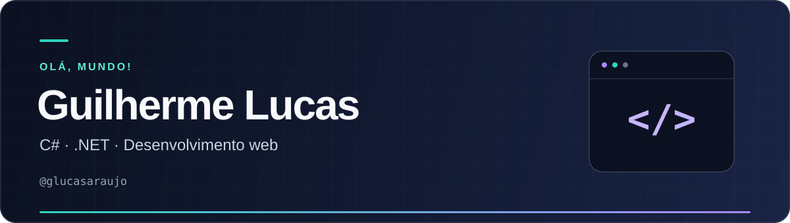

  

  

## 👋 Olá! Eu sou o Guilherme Lucas

Por aqui, compartilho projetos e estudos em **C# e .NET**, com foco em APIs, aplicações web e persistência de dados.

- 🛠️ **Backend:** C#, ASP.NET Core e Entity Framework Core.
- 🌐 **Web:** Razor Pages, Blazor e Bootstrap.
- 🗄️ **Dados:** SQL Server e modelagem de dados.

## ⚡ Tecnologias presentes nos meus projetos

  
  
  
  

  
  
  
  

## 🚀 Projetos para conhecer

| Projeto | O que você encontra | Tecnologias |
| :--- | :--- | :--- |
| [🌐 FullStackWebApp](https://github.com/glucasaraujo/FullStackWebApp) | Aplicação web para cadastro de pessoas e seus dependentes. | ASP.NET Core · Razor Pages · EF Core · SQL Server |
| [💰 Jornada Fullstack](https://github.com/glucasaraujo/jornada-fullstack-2024-baltaio) | Estudos da Jornada Fullstack do balta.io, com estrutura de API e aplicação Blazor para o domínio financeiro. | .NET · ASP.NET Core · Blazor |
| [🎮 Jogo Gourmet](https://github.com/glucasaraujo/JogoGourmet) | Jogo de perguntas sobre pratos, desenvolvido para desktop. | C# · Windows Forms |

  <a href="https://github.com/glucasaraujo?tab=repositories"><strong>Veja todos os repositórios →</strong></a>

